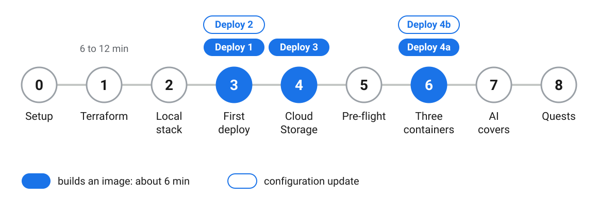

# Rails 8 on Google Cloud

<p class="event">Helvetic Ruby 2026, Zurich</p>
<p class="speaker">Riccardo Carlesso</p>
<p class="fine">Co-author: Emiliano Della Casa</p>

<!--
Welcome. Three hours, hands-on, 13:30 to 16:30.
This workshop was co-created with Emiliano Della Casa of RubyCon Italy; a good part of what you will see is his work.
What you get this afternoon, in this order:
1. A Rails 8 app that is a solid blueprint for running the classic monolith in the cloud.
2. A codelab that is fun to walk through.
3. Practice working with a coding harness, whichever one you already use.
The first 25 minutes are a code tour with five stops. Then you open the codelab and I stop talking.
-->

---

<!-- _class: vcenter -->

# From `rails new` to the cloud

<p class="punchline">Disk state.<br>Jobs inside Puma.<br>One master key.</p>

<!--
Rails 8 gives you a great single-server story: SQLite files and uploads under storage/, Solid Queue running inside Puma (blog/config/puma.rb line 38, SOLID_QUEUE_IN_PUMA), and a master key you carry around.
On a platform that starts a clean container for every revision and scales to zero, each of these bites: the data is gone, the jobs stop when no request is running, and the key has to live somewhere.
You will see all three happen for real in Step 3 of the codelab. The next five slides are how this repo answers them.
-->

---

# One-line JSON logs

<p class="path"><code>blog/config/environments/production.rb</code></p>

```ruby
require "google_json_formatter"
logger = ActiveSupport::Logger.new(STDOUT)
logger.formatter = GoogleJsonFormatter.new
config.logger = logger
```

<p class="path"><code>blog/lib/google_json_formatter.rb</code></p>

```ruby
payload = {
  severity: gcp_severity,
  time: timestamp.respond_to?(:iso8601) ? timestamp.iso8601 : Time.now.utc.iso8601,
  message: message_str
}
# ...
payload.to_json + "\n"
```

<!--
Tour stop 1.
production.rb lines 48 to 51: a plain ActiveSupport::Logger on STDOUT with a formatter of our own. Set LOG_FORMAT=plain and you get the stock tagged logger back (lines 44 to 46).
google_json_formatter.rb is 68 lines with no gem dependency: lines 24 to 28 build the payload, line 42 writes one JSON object per line. Lines 10 to 17 map Rails severities to the names the log collector expects, and lines 32 to 40 attach a trace id when there is one.
Why it matters: a multi-line Rails stack trace becomes one searchable log entry instead of forty. Any log collector that reads JSON from STDOUT benefits; only the field names are specific to Google.
-->

---

# Solid Queue, Cache and Cable in three containers

<p class="path"><code>blog/config/environments/production.rb</code></p>

```ruby
config.cache_store = :solid_cache_store
config.active_job.queue_adapter = :solid_queue
config.solid_queue.connects_to = { database: { writing: :queue } }
```

<div class="cols wide-left small-code">
<div>

<p class="path"><code>blog/compose.prod.yaml</code></p>

```yaml
services:
  web:
    x-google-cloudrun:
      ingress-container: true
  worker:
    # command: ... rails solid_queue:start ...
  cloudsql-proxy:
    image: gcr.io/cloud-sql-connectors/cloud-sql-proxy:2
```

</div>
<div>
<p class="say">No Redis.<br>No Kubernetes.</p>
</div>
</div>

<!--
Tour stop 2.
production.rb line 64 is Solid Cache, lines 67 and 68 are Solid Queue on its own database; config/cable.yml line 12 is Solid Cable. Everything that used to need Redis now sits in PostgreSQL.
compose.prod.yaml declares three containers: web at line 8 (Puma, the only one that receives HTTP), worker at line 32 (the full command is on line 36, it retries until the database is ready), and cloudsql-proxy at line 53.
The YAML on the slide is shortened; the environment blocks are on the next stops.
The same Compose file is what gets deployed: one service, three containers, one command. That is Deploy 4a in the codelab.
-->

---

<!-- _class: vcenter -->

# Private files, keyless signed URLs

<div class="cols wide-left">
<div>

<p class="path"><code>blog/config/storage.yml</code></p>

```yaml
google_prod: &google_prod
  service: GCS
  project: <%= gcp_project %>
  bucket: <%= gcp_project %>-activestorage-prod
  iam: true
  gsa_email: <%= gcs_signer_sa %>
```

</div>
<div>
<p class="say">Private bucket.<br>Expiring URLs.<br>No key file.</p>
</div>
</div>

<!--
Tour stop 3.
storage.yml lines 63 to 68. The line to look at is 67: iam: true.
A container on Cloud Run has an identity but no private key on disk, so Active Storage cannot sign a URL locally. With iam: true it asks the IAM Credentials API to sign on its behalf. The long comment at the top of the file (lines 1 to 17) tells the story of the bug that led here.
Result: the bucket stays private, every image URL is signed and expires, and there is no JSON key file to leak or rotate.
Line 68, gsa_email, names the signing service account so that the same config also works from a laptop.
-->

---

# Database through a sidecar, secrets at runtime

<p class="path"><code>blog/config/database.yml</code></p>

```yaml
postgres_from_parts: &postgres_from_parts
  adapter: postgresql
  host: <%= ENV["DB_HOST"].to_json %>
  port: <%= ENV.fetch("DB_PORT", "5432").to_i %>
  database: <%= ENV.fetch("DB_NAME", "rails_production").to_json %>
  username: <%= ENV.fetch("DB_USER", "rails_user").to_json %>
  password: <%= ENV["DB_PASSWORD"].to_json %>
```

<p class="path"><code>workshop/CODELAB.md</code>, Step 6 (shortened)</p>

```bash
gcloud run services update blog ... \
  --container=web    ... --set-secrets="$APP_SECRETS" \
  --container=worker ... --set-secrets="$APP_SECRETS"
```

<!--
Tour stop 4.
database.yml lines 51 to 57: production builds its PostgreSQL connection from five plain settings. DB_HOST is cloudsql-proxy (compose.prod.yaml line 21): the app talks to the Cloud SQL Auth Proxy sidecar, which opens an encrypted tunnel to Cloud SQL authorised by the identity of the service. The database login itself still uses the user and the password.
Line 50 is the switch: without DB_PASSWORD the app stays on SQLite. That is why Deploy 4a comes up with three containers and still shows the "ephemeral database" banner.
compose.prod.yaml carries no secret values at all. Deploy 4b is one command that mounts two secrets from Secret Manager, RAILS_MASTER_KEY and DB_PASSWORD, on web and on worker, and switches to a dedicated service account. The command on the slide is shortened; the full one is in Step 6 of the codelab.
After that, the service configuration contains only references to secrets, no values. The codelab shows how to check it.
-->

---

# AI as a background job, no API key

<p class="path"><code>blog/app/jobs/generate_cover_image_job.rb</code></p>

```ruby
prompt = Nanobanana.prompt_for(post.title, post.body.to_plain_text)
result = Nanobanana.generate_image(prompt)
```

<div class="cols wide-left">
<div>

<p class="path"><code>blog/lib/nanobanana.rb</code></p>

```ruby
def generate_image(prompt)
  if project_id.present?
    generate_via_vertex_ai(prompt)
  else
    fake_cover("GOOGLE_CLOUD_PROJECT is not set")
  end
end
```

</div>
<div>
<p class="say">No credentials?<br>Placeholder cover.</p>
</div>
</div>

<!--
Tour stop 5.
Saving a post without a cover enqueues GenerateCoverImageJob (blog/app/models/post.rb line 17). The job is 32 lines; lines 15 and 16 are the whole AI part. It runs in the worker container through Solid Queue, and line 28 pushes the result to the browser with a Turbo refresh.
nanobanana.rb is the only file that knows about the model. Lines 97 to 103: with a project id it calls Vertex AI, otherwise it returns a bundled placeholder image. Lines 168 to 170 fetch Application Default Credentials: the identity of the container in the cloud, your own login on a laptop. There is no API key anywhere in this repository; the project constitution forbids it (section 11).
Honest expectations: in the local Docker Compose stack the containers hold no Google credentials, so a new post gets the placeholder cover. On Cloud Run the cover is generated for real; on the live run of 18 Nov it took about 3 minutes to appear.
-->

---

<!-- _class: vcenter -->

# The same blueprint elsewhere

| Seam | Google Cloud | AWS | Azure |
|---|---|---|---|
| Containers | Cloud Run | ECS Fargate or App Runner | Container Apps |
| PostgreSQL | Cloud SQL | RDS | Azure Database for PostgreSQL |
| Object storage | Cloud Storage | S3 | Blob Storage |
| Secrets | Secret Manager | Secrets Manager | Key Vault |
| AI models | Vertex AI | Bedrock | Azure OpenAI |

<p class="fine">Only the Google Cloud column is built and tested in this repo.</p>

<!--
This is the slide for the sceptics, and I am one of you.
The five stops are five seams. Section 13 of docs/CONSTITUTION.md names the files where provider-specific code is allowed to live: storage.yml, database.yml, compose.prod.yaml, google_json_formatter.rb, nanobanana.rb, plus the infrastructure folder. Models, controllers, views and jobs do not call a cloud SDK.
So the pattern travels: containers from one Compose file, managed PostgreSQL, private object storage with signed URLs, secrets injected at runtime, JSON logs on STDOUT.
Read the small print out loud: only the Google Cloud column is built and tested in this repo. The other two columns are a map of service names, not a claim that it works there today.
-->

---

<!-- _class: vcenter -->

# Bring your own coding harness

<div class="cols">
<div>
<p class="say">Keep yours: Claude Code, Codex, Gemini CLI.</p>
<p class="say" style="margin-top: 1em;">Or Antigravity + Gmail.</p>
</div>
<div>

```text
AGENTS.md
CLAUDE.md      -> AGENTS.md
GEMINI.md      -> AGENTS.md
.claude/skills -> ../skills
.agents/skills -> ../skills
```

</div>
</div>

<!--
Hands-on part starts here.
You will pair with a coding agent this afternoon. Use the one you already have and trust: Claude Code, Codex, Gemini CLI, Cursor. If you have none, install Antigravity and sign in with a personal Gmail account.
The repository serves all of them with one set of instructions. AGENTS.md is the real file; CLAUDE.md and GEMINI.md are symlinks to it, and the skills folder is linked where each harness looks for it. Section 12 of the constitution says no step may require a specific harness: everything can be done from the codelab and the just recipes alone.
The fast-start prompts for both paths are on the event page: workshop/events/20261119-helvetic-ruby/README.md.
-->

---

<!-- _class: vcenter -->

# Start with the codelab

<div class="cols qr-right">
<div>
<p class="big-link"><a href="https://palladius.github.io/rails8-app-on-gcp/codelab/" target="_blank" rel="noopener noreferrer">palladius.github.io/rails8-app-on-gcp/codelab/</a></p>
<p style="margin-top: 1.2em;">Credits first, then follow the codelab:</p>
<p class="fine" style="white-space: nowrap;"><a href="https://codelabs.developers.google.com/codelabs/rails8-on-google-cloud#1" target="_blank" rel="noopener noreferrer">codelabs.developers.google.com/codelabs/rails8-on-google-cloud#1</a></p>
</div>
<div style="text-align: center;">

</div>
</div>

<!--
Scan the code or type the address. This is the up-to-date codelab, built from workshop/CODELAB.md on every merge.
Credits first. The claim banner is on page 2 (Step 0) of the Google-hosted copy of the codelab: the small address on the slide. Open it signed in with a personal Gmail account, claim the credits, then come back to the page behind the QR code.
Do the lab on the GitHub Pages version, not on the Google-hosted copy: that copy is an older version of the text. The GitHub Pages version has no claim banner (checked on 18 Nov 2026).
Leave this slide up until everyone has the page open.
-->

---

# Guardrails for you and your agent

```bash
cat docs/CONSTITUTION.md   # the rules of the repository
just workshop-test         # pre-flight diagnostics for your machine
just workshop-eval 3       # automated checks for Step 3
```

<p class="say" style="margin-top: 1.6em;">Evals do not verify<br>your deployed service.</p>

<!--
Three things keep you and your agent on the road.
docs/CONSTITUTION.md is short and it is the law of the repo: your agent reads it through AGENTS.md.
just workshop-test runs the pre-flight diagnostics: account, billing, credentials. Run it first, and again whenever something looks odd.
just workshop-eval N runs the checks for step N. They are defined in workshop/skeleton.yaml.
Be clear about the limit: most evals look at your working copy and run local tests. Step 5 also asks your project whether the secrets and the database exist. None of them asserts on the deployed Cloud Run service, so a green eval does not prove that your deploy is in the right state. For that, open the URL and read the banner in the app, or ask me.
-->

---

<!-- _class: vcenter -->

# Nine steps, four deploys



<!--
The route for the afternoon. Steps 0 to 2 are setup, Terraform and the local stack. Step 3 is your first deploy, and the moment the stateless platform bites. Step 4 adds Cloud Storage. Step 5 is a pre-flight check. Step 6 is the three-container deploy, in two parts: 4a brings up the containers, 4b mounts the secrets. Step 7 is the AI job, Step 8 is free choice.
Timing measured on live runs on 18 Nov: every deploy that builds an image takes about 6 minutes (Deploy 1, Deploy 3, Deploy 4a). Terraform in Step 1 takes 6 to 12 minutes, mostly waiting for Cloud SQL (two runs: five and a half minutes, then eleven and a half). Start Terraform early and read ahead while it runs.
Deploy 2 and Deploy 4b only change configuration; they are quick.
Nobody is expected to finish Step 8 today. Reaching Step 6 is a good afternoon.
-->

---

<!-- _class: vcenter -->

# Questions welcome

<table class="contacts">
<tr>
<td><a href="https://github.com/palladius" target="_blank" rel="noopener noreferrer"><svg viewBox="0 0 24 24" fill="#1a1a1a" aria-hidden="true"><path d="M12 .297c-6.63 0-12 5.373-12 12 0 5.303 3.438 9.8 8.205 11.385.6.113.82-.258.82-.577 0-.285-.01-1.04-.015-2.04-3.338.724-4.042-1.61-4.042-1.61C4.422 18.07 3.633 17.7 3.633 17.7c-1.087-.744.084-.729.084-.729 1.205.084 1.838 1.236 1.838 1.236 1.07 1.835 2.809 1.305 3.495.998.108-.776.417-1.305.76-1.605-2.665-.3-5.466-1.332-5.466-5.93 0-1.31.465-2.38 1.235-3.22-.135-.303-.54-1.523.105-3.176 0 0 1.005-.322 3.3 1.23.96-.267 1.98-.399 3-.405 1.02.006 2.04.138 3 .405 2.28-1.552 3.285-1.23 3.285-1.23.645 1.653.24 2.873.12 3.176.765.84 1.23 1.91 1.23 3.22 0 4.61-2.805 5.625-5.475 5.92.42.36.81 1.096.81 2.22 0 1.606-.015 2.896-.015 3.286 0 .315.21.69.825.57C20.565 22.092 24 17.592 24 12.297c0-6.627-5.373-12-12-12"/></svg></a></td>
<td class="label">GitHub</td>
<td class="link"><a href="https://github.com/palladius" target="_blank" rel="noopener noreferrer">github.com/palladius</a></td>
</tr>
<tr>
<td><a href="https://github.com/palladius/rails8-app-on-gcp" target="_blank" rel="noopener noreferrer"><svg viewBox="0 0 16 16" fill="#1a1a1a" aria-hidden="true"><path d="M2 2.5A2.5 2.5 0 0 1 4.5 0h8.75a.75.75 0 0 1 .75.75v12.5a.75.75 0 0 1-.75.75h-2.5a.75.75 0 0 1 0-1.5h1.75v-2h-8a1 1 0 0 0-.714 1.7.75.75 0 1 1-1.072 1.05A2.495 2.495 0 0 1 2 11.5Zm10.5-1h-8a1 1 0 0 0-1 1v6.708A2.486 2.486 0 0 1 4.5 9h8ZM5 12.25a.25.25 0 0 1 .25-.25h3.5a.25.25 0 0 1 .25.25v3.25a.25.25 0 0 1-.4.2l-1.45-1.087a.249.249 0 0 0-.3 0L5.4 15.7a.25.25 0 0 1-.4-.2Z"/></svg></a></td>
<td class="label">Repository</td>
<td class="link"><a href="https://github.com/palladius/rails8-app-on-gcp" target="_blank" rel="noopener noreferrer">github.com/palladius/rails8-app-on-gcp</a></td>
</tr>
<tr>
<td><a href="https://ricc.rocks" target="_blank" rel="noopener noreferrer"><svg viewBox="0 0 24 24" fill="none" stroke="#1a1a1a" stroke-width="1.8" stroke-linecap="round" aria-hidden="true"><circle cx="12" cy="12" r="10"/><path d="M2 12h20M12 2a15.3 15.3 0 0 1 0 20M12 2a15.3 15.3 0 0 0 0 20"/></svg></a></td>
<td class="label">Web</td>
<td class="link"><a href="https://ricc.rocks" target="_blank" rel="noopener noreferrer">ricc.rocks</a></td>
</tr>
</table>

<!--
Keep this slide up while people work.
Raise a hand as soon as you are stuck for more than five minutes: a blocked attendee is my problem, not yours.
Issues and pull requests on the repository are welcome, today or later. The workshop was co-created with Emiliano Della Casa; Daniel Strebel and Guillaume Laforge contributed ideas that are credited in the changelog.
-->
